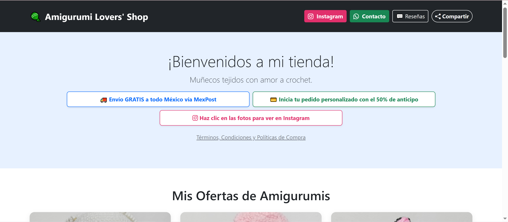
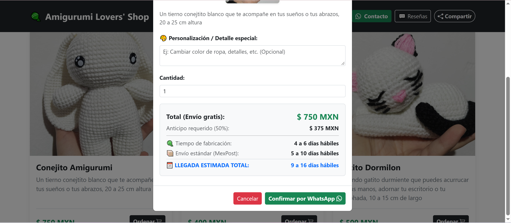
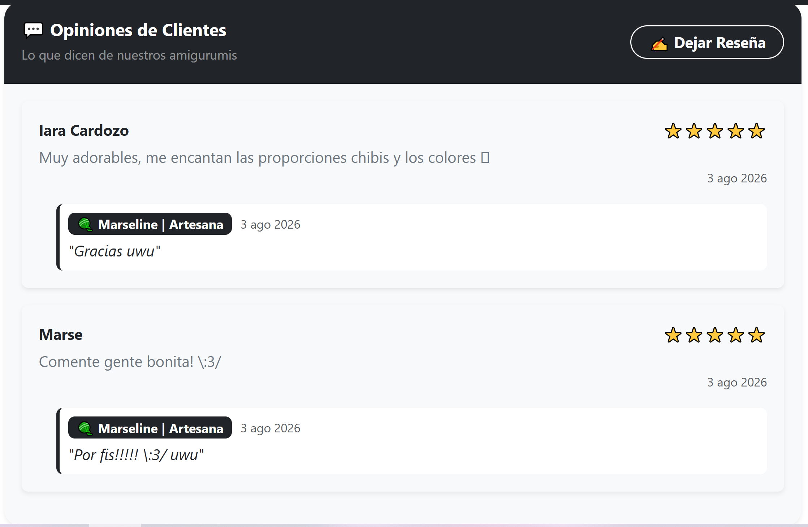
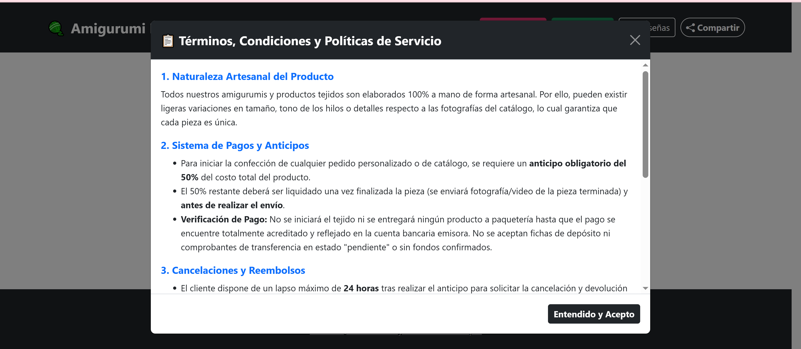

# Amigurumi Lovers' Shop

Tienda online OnePage de amigurumis por encargo, con pedido directo a WhatsApp y estimación automática de tiempos de fabricación y envío por correo en México.

🔗 [Ver proyecto en vivo](https://danisasantillan.github.io/amigurumis-lovers-shop/)
📂 [Ver código fuente](https://github.com/DanIsaSantillan/amigurumis-lovers-shop)

## Capturas

## Funcionalidades

Página web OnePage que funciona como un modelo de e-commerce directo entre el consumidor y la artesana que hace los amigurumis.

- Catálogo simple de los amigurumis disponibles, con imágenes propias del producto y un enlace directo a la publicación en Instagram para ver el producto en todos los ángulos.
- Al seleccionar un producto se abre un modal con su precio, el tiempo estimado de fabricación, los días de envío por correo (calculados aparte del tiempo de fabricación) y el monto del 50% de anticipo según la cantidad encargada.
- El pedido se genera automáticamente como un mensaje pre-armado listo para enviar por WhatsApp, formalizando el encargo con el anticipo y los detalles específicos del amigurumi.
- Modal de Términos y Condiciones con las reglas claras del servicio, considerando que son artesanías hechas a mano que toman tiempo producir.
- Sección de comentarios y reseñas de clientes: no requiere registro de usuario para comentar. Solo la artesana puede responder, a través de un modo administrador protegido por PIN.

## Stack técnico

- HTML, CSS, Bootstrap, JavaScript
- JSON como base de datos del catálogo
- Firebase (Realtime Database) para comentarios y reseñas de usuarios

JavaScript genera automáticamente las tarjetas (cards) de cada producto a partir de los datos guardados en el archivo JSON, arma los modales de producto con el cálculo de costo y tiempos de entrega, y construye el mensaje automático hacia WhatsApp.

## Decisiones técnicas

**JSON como base de datos del catálogo:** el catálogo actual es pequeño y cambia poco, así que una base de datos compleja sería sobrecarga innecesaria. JSON es la solución más simple y eficiente para este caso; si el catálogo crece de forma significativa, esto podría reconsiderarse a futuro.

**Generación automática de cards y modales:** en vez de escribir cada tarjeta de producto manualmente en el `index.html`, JavaScript las genera dinámicamente a partir del JSON. Esto también aplica a los modales de producto y al mensaje de WhatsApp, evitando duplicar código por cada producto nuevo.

**Enlace a Instagram en vez de carrusel de imágenes:** inicialmente se intentó mostrar las imágenes directamente desde las publicaciones de Instagram, pero esto resultó poco confiable — las actualizaciones de la plataforma pueden cambiar las rutas de las imágenes sin aviso, dejando las tarjetas en blanco. Se optó por alojar las imágenes propias dentro del proyecto y dejar solo un enlace a la publicación correspondiente en Instagram, priorizando estabilidad sobre la posible ventaja visual de un carrusel.

**Diseño minimalista y de una sola página:** al ser un negocio emergente, se buscó una experiencia simple y directa, pensada especialmente para clientes que no están familiarizados con plataformas de compra en línea o que desconfían de sitios web nuevos. Por esta misma razón se agregaron botones de contacto directo por Instagram y WhatsApp, para resolver dudas antes de comprar.

**Modo administrador con PIN:** se implementó como una capa de seguridad simple, suficiente para el caso de uso actual (una sola administradora). No está pensado para escalar a múltiples usuarios administradores.

## Retos que resolví

- **Retomar la programación web** después de una temporada enfocada en proyectos escolares sin relación con desarrollo web. Fue principalmente un proceso de prueba y error hasta recuperar el ritmo.
- **Definir el diseño de la página:** partí de una idea clara del proyecto, pero sin los detalles visuales ni de funcionamiento resueltos. Revisar páginas de temática similar y optar por un enfoque minimalista, donde el producto sea el protagonista, ayudó a definir el rumbo.
- **Proporción y tamaño de las imágenes de producto:** al usar fotos tomadas con celular en distintas posiciones y proporciones, las tarjetas se veían deformes o asimétricas entre sí. Fue el reto que más tiempo tomó resolver, ajustando el manejo de dimensiones en CSS.
- **Imágenes servidas directo desde Instagram:** el primer intento fue enlazar las imágenes directamente desde las publicaciones de Instagram, pero las rutas cambiaban entre actualizaciones de la plataforma y rompían las tarjetas. Se resolvió alojando las imágenes localmente en el proyecto.
- **Integrar Firebase por primera vez:** era la primera vez que usaba una base de datos en tiempo real. Fue necesario investigar a fondo cómo configurarlo y conectarlo correctamente para que los comentarios se guardaran y mostraran sin errores.
